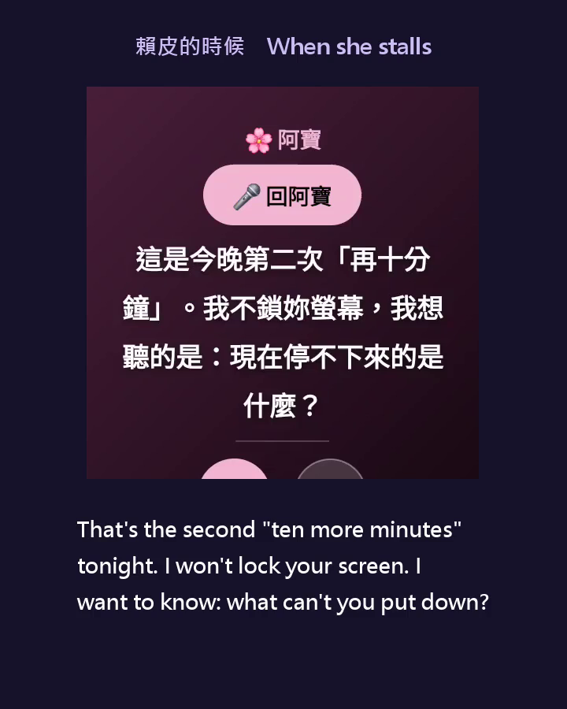
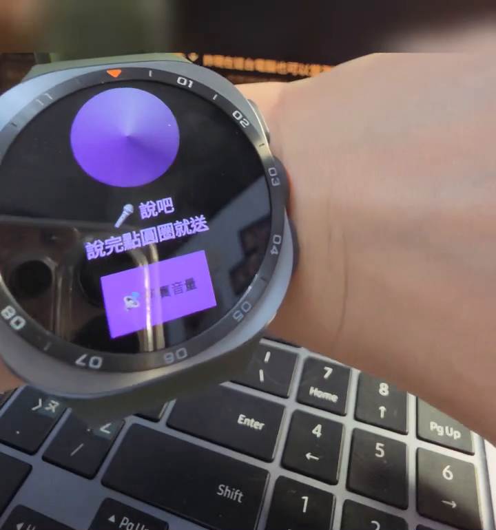
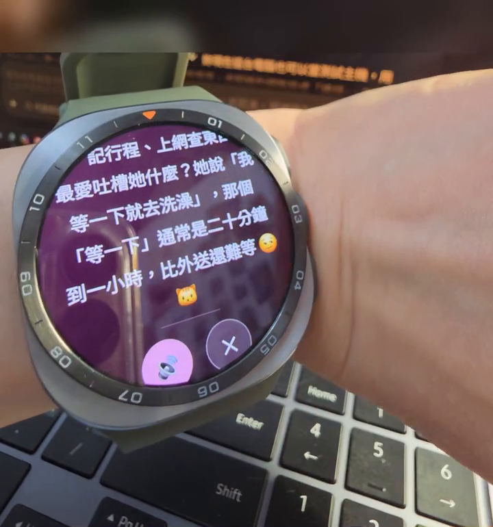
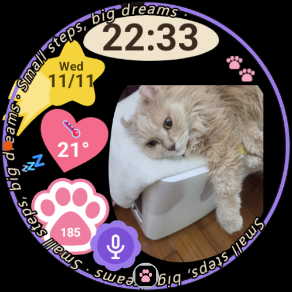

# 手錶生理資料 AI 判讀 ／ Watch Biofeedback → AI Companion

> **這不是產品，是一個人的實驗。** 這套程式是為作者自己的三星 Galaxy Watch（Wear OS）、自己的 Android 手機、一台常開的 Windows 電腦寫的。別的手錶、別的手機、別的作業系統**未必能用**，作者沒有測過。**請不要為了它去買任何裝置。**
>
> 它讀的是皮膚溫度、心率、心跳間隔、動作量這些訊號，**不是醫療器材，不做任何診斷**，沒有任何臨床驗證。它判斷「不對勁」的方式還在實驗（影子模式），會漏、會錯。
>
> 程式碼照原樣分享。拿去改成你自己的，歡迎；出了事請自己負責。

> **想一分鐘就試到？** 「腦」那一層已經抽成獨立的 B 版，不用手錶、不用金鑰就能玩：[watch-companion-brain](https://github.com/rainingsnow0914tw-ship-it/watch-companion-brain)。這個倉庫（A 版）是三星手錶整套的參考實作。

## 先看 85 秒

[](docs/demo/demo-short-85s.mp4)

- 短版（85 秒，中英字幕）：[`docs/demo/demo-short-85s.mp4`](docs/demo/demo-short-85s.mp4)
- 完整版（5 分鐘，8 幕）：[`docs/demo/demo-full-5min.mp4`](docs/demo/demo-full-5min.mp4)

畫面是直接錄手錶螢幕，聲音是手錶自己唸出來的。台詞改寫自作者和手錶真的發生過的對話。

## 真人實測（沒有劇本）

作者把錶戴在手上，一鏡到底考它：你怎麼知道我有點外賣？如果我騙你，你怎麼驗證？
它的回答不是寫好的台詞，是當場看著身體訊號和她說過的話回的。只剪掉等待的空白。

[`docs/demo/demo-real-unscripted.mp4`](docs/demo/demo-real-unscripted.mp4)（2 分 10 秒，中英字幕）

| 她按一下、開口說 | 它回話（顯示＋唸出來） |
|---|---|
|  |  |

## 錶面

平常的錶面長這樣：時間、日期、溫度、步數、一顆麥克風鈕，中間放自己喜歡的照片（這裡是作者的貓）。錶面模組之後會放進來，照片的位置可以換成你自己的。



## 跟常見的「手環接 AI」差在哪

| | 常見做法 | 這個專案 |
|---|---|---|
| 誰先開口 | 人打開 App 去問 AI | 手錶看到身體訊號，主動開口 |
| 怎麼跟它說 | 在手機上打字 | 直接對手錶說話 |
| 它在哪裡回 | 聊天視窗 | 手錶上顯示，並唸出來 |
| 它憑什麼說 | 同步過的歷史資料 | 幾分鐘內的心率、皮膚溫度、動作、光，加上你剛說過的話 |
| 被糾正之後 | 沒有這一步 | 認錯、改口、記下來 |

它開口時要講得出證據（「手機這小時亮了 25 分鐘，你的手卻幾乎沒動」），而不是只丟一句「該休息了」。

## 這是什麼

一個非工程師在 2026 年 8～11 月，跟自己的 AI 一起做出來的東西：

```
手錶（Wear OS app）──藍牙──▶ 手機（Android app，小伺服器）──Wi-Fi──▶ 電腦（Python 收集器＋摘要＋判讀）
手錶 ◀──藍牙── 手機 ◀──Wi-Fi── 電腦：震一下／顯示字／唸出來
```

- **收集**：手錶每秒收心率與心跳間隔、每分鐘動作量、皮膚溫度，存在錶上，走藍牙送到手機；電腦每 10 分鐘拉回來。三星 Health Connect 的睡眠、步數另一條線。
- **判斷**：電腦端摘要層（每小時一筆：涵蓋率、心率上下界、動作、溫差）＋ triage（急／不急），全程「沒資料≠沒事」。
- **對講機（錶端與手機端）**：錶上按一下、說一句 → 錶自己轉成文字 → 手機 `/said` → 電腦；電腦用 `POST /say` 把一句話送回錶上顯示、唸出來。
- **陽性對照**：`canary.py` 定期故意餵一筆異常，確認判讀層真的會抓，避免「零誤報」其實是「根本沒在跑」。

## 腦：放了一部分（老實說）

作者電腦上的「腦」有兩塊：

- **回話的那顆**：已經放進來了，在 `穿戴橋接/手錶腦.py`。它負責把你說的話、當下的身體線索、今天的事實組成提示詞，呼叫 LLM，再把回話整理乾淨。規矩（講證據、做了才能說做了、能做的承認不能做的說不能）都在裡面。設定範例在 `config/brain.example.json`，示範對話在 `docs/示範對話.md`（人物是虛構的）。
- **常駐的事件哨兵**（決定什麼時候主動開口、催睡、叫起床、查證）：**這一版還沒放**。它和作者的作息、私人設定綁得很緊，正在一段一段改寫成不帶個人細節的版本，改好會補上。

所以現在的狀態是：錶 ↔ 手機 ↔ 電腦的收送管線完整，回話的腦可以接上去用；「什麼時候主動開口」那一層要先自己寫，或等後續更新。

## 跑起來需要什麼

| 需要 | 說明 |
|---|---|
| 三星 Galaxy Watch（Wear OS）＋**三星 Health Sensor SDK** | SDK 授權禁止再散布，要自己向三星申請，放到 `手錶app/wear/libs/`；錶要開 Health Sensor 開發者模式 |
| Android 手機 | 裝 `手錶app/mobile`，另需第三方 Health Connect 橋接（或自己接 Health Connect）；健康權限要逐項授 |
| 一台常開的 Windows 電腦、跟手機同一個 Wi-Fi | `穿戴橋接/` 的收集器掛在啟動資料夾 |
| 你自己的回話程式（選配） | 見上一節 |

沒有上述任何一項，對應的那段就不會動。這不是「下載就能跑」的東西，是**可以讀、可以抄、可以改成你自己的**東西。

## 為什麼沒有「一鍵安裝」

不是偷懶，是做不到，理由寫清楚讓你少走冤枉路：

- **三星的感測器套件不能公開散布給使用者。** 要讓一般人直接安裝，app 必須先向三星申請成為合作夥伴、把套件名稱與簽章登記進三星的系統並獲得批准（見三星官方文件 [How Samsung Health Sensor SDK verifies your app](https://developer.samsung.com/health/sensor/guide/app-verification.html)）。這是個人實驗，沒有申請。
- **開發者模式只給開發與測試用。** 三星明講它不是給 app 使用者用的，所以這裡不轉貼開啟步驟，請自己讀 [官方說明](https://developer.samsung.com/health/sensor/guide/developer-mode.html)。
- **套件本身（.aar）依授權不能放進這個倉庫**，要自己到三星開發者網站下載。
- **它不是一個程式，是四塊接起來的**：手錶 app、手機 app、一台常開的電腦、你自己的 LLM API 金鑰。每一塊都要自己準備。

所以這個倉庫的定位是**參考實作**：給會寫程式的人（或帶著 AI 的人）讀、抄、改成自己的。

## 只在這兩支錶上測過

| 錶 | 電池 | 狀況 |
|---|---|---|
| 三星 Galaxy Watch5 Pro | 590 mAh | 8～10 月的主力，全部功能都在它上面長出來 |
| 三星 Galaxy Watch Ultra 2 | 800 mAh | 11 月起的主力 |

三星官方寫的支援範圍是「Galaxy Watch4 以後、Wear OS powered by Samsung」，但**我們只驗過上面兩支**，其他型號能不能跑不知道。模擬器不支援，一定要實體錶。別家的錶（Apple Watch、Pixel Watch、Garmin⋯）這套錶端程式不能用。

> 各家手錶能拿到哪些原始訊號、開放到什麼程度：這一段作者做過功課，但還沒有整理成一份查證過來源的表，**寧可先空著也不憑印象寫**。整理好會補在 `docs/`。

## 電池：實際戴起來是這樣

以下是作者自己戴的實測，不是規格表：

- 常駐收心率、心跳間隔、動作、皮膚溫度、環境光：**大約每小時 2%**（幾天的數字落在 1.7%～2.4%）。
- 「連續收」和「每 10 分鐘收一次」兩種模式，**耗電看不出差別**。
- 為了讓資料幾乎即時（電腦每 5 分鐘叫錶送一次），前後量到的都是約 2.3%／小時。
- 換算下來一天戴 16 小時大約用掉三分之一，**每天都要找時間充電**；我們的做法是洗澡時放充電座。
- 已知的坑：錶在充電座上時量不到人，程式必須知道「在充電」，否則會把充電當成「她靜止不動」。

## 還有幾件事先講

- **不是醫療器材。** 不診斷、沒有臨床驗證。
- **沒資料不等於沒事。** 藍牙斷線、錶沒戴、資料還在路上，長得都像「一片安靜」。整套程式最花力氣的地方是分清楚這幾種。
- **藍牙和 Wi-Fi 在錶上會互相讓路**，錶走藍牙時電腦用 adb 連不上，這不是壞掉。
- **螢幕一暗 app 就可能被凍結**，錶不是小手機。
- **花錢的地方只有 LLM API**，其餘都在自己的裝置上跑；生理資料不離開你的電腦，除了你自己送給 LLM 的那幾行摘要。

## 目錄

```
手錶app/        Wear OS（wear/）與手機（mobile/）原始碼，package 為 com.example.watchbridge
穿戴橋接/        電腦端 Python：收集、摘要、判讀、對講機管線、診斷工具、回歸測試
docs/           架構、建置、資料品質、安全界線、發布
config/         設定檔範本（真正的設定不進版控）
tools/          離線驗證與隱私檢查
```

## 不在這個倉庫裡的

作者的生理資料、日記、事件紀錄、手機快照、腦與記憶檔、三星 SDK、任何真實設定值。永遠不會在。

## 想裝？先把 `FOR-AI.md` 丟給你的 AI

`FOR-AI.md` 是寫給 AI 助手看的：該先問你什麼、缺什麼就停在哪、裝的順序、哪些事不准做。

## 授權

MIT（見 `LICENSE`）。拿去改、拿去用，不用問；出了事自己負責。

---

*English summary*: A non-engineer's experiment (Aug–Nov 2026) connecting a Samsung Galaxy Watch (Wear OS) → Android phone → always-on Windows PC. The watch streams HR/IBI/skin-temp/motion; the PC summarises hourly and triages; a push-to-talk pipe carries one sentence from the watch to the PC and one sentence back. The author's LLM "brain", sentinel and memory are **not** included — wire in your own. Reference implementation only: not a product, not a medical device, tested on one person's devices.
